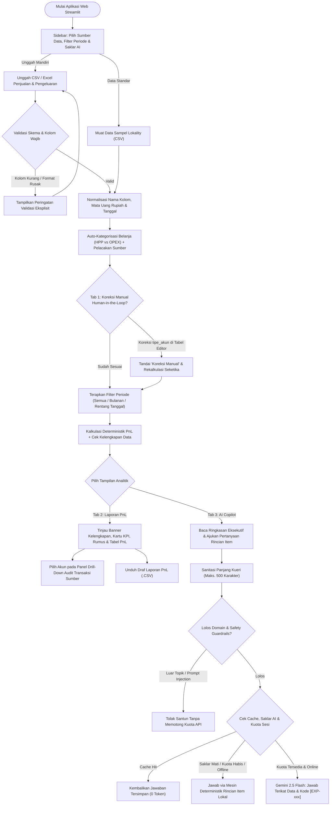
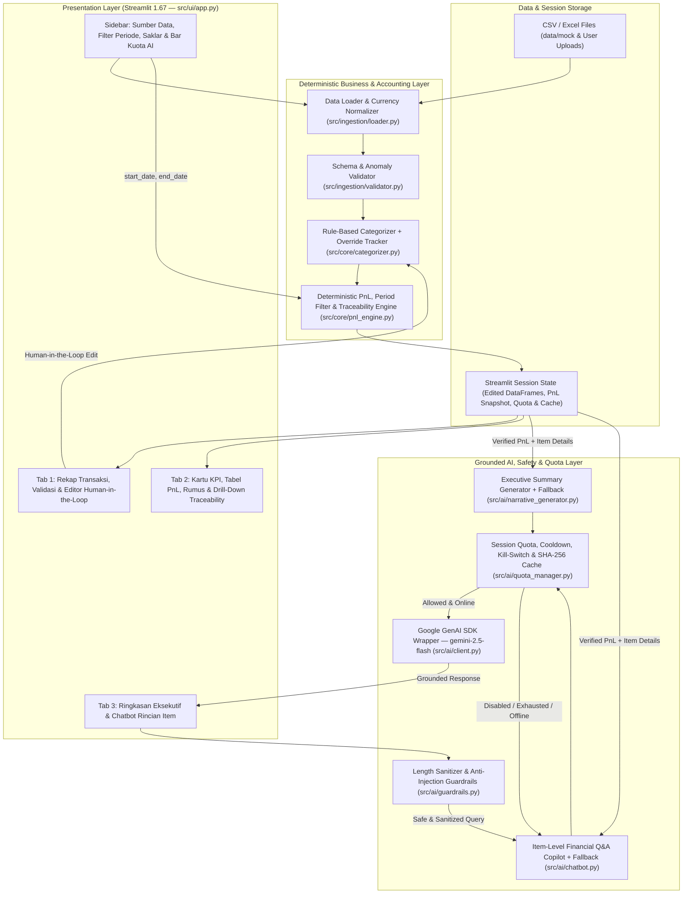

# AI Solution Blueprint & Architecture
## AI Solution for Enterprise — Capstone Business Project

---

### Tujuan Dokumen
Dokumen ini mendefinisikan arsitektur teknis, alur pengguna (*User Flow*), dan pemilihan teknologi untuk aplikasi **Lokality AI Financial Recap & PnL Copilot** (Versi 1.1) pada PT Lokal Komoditi Indonesia (Kasus ID: `LKI-01`). Dokumen ini menjembatani kebutuhan bisnis pada BRD dengan implementasi modular di repository kode.

---

### 1. User Flow Diagram

Diagram berikut menggambarkan interaksi dua persona pengguna (**Pengelola Data** dan **Peninjau Hasil / Manajemen Lokality**), termasuk filter periode, koreksi kategori *Human-in-the-Loop*, *drill-down* keterlacakan angka PnL, serta pengendalian kuota & *guardrails* AI.

> Berkas diagram resolusi tinggi juga tersedia pada [`docs/diagrams/user_flow_diagram.png`](diagrams/user_flow_diagram.png) dan sumber [`docs/diagrams/user_flow_diagram.mmd`](diagrams/user_flow_diagram.mmd).

---

### 2. AI Solution Architecture Diagram

Arsitektur sistem menerapkan pemisahan tegas antara **Deterministic Accounting Engine** (menjamin akurasi matematis 100% dan keterlacakan baris sumber) dan **Grounded Generative AI Layer** (dilengkapi *Guardrails*, *Session Quota Manager*, *Response Cache*, dan *Deterministic Offline Fallback*).

> Berkas diagram resolusi tinggi tersedia pada [`docs/diagrams/architecture_diagram.png`](diagrams/architecture_diagram.png) dan sumber [`docs/diagrams/architecture_diagram.mmd`](diagrams/architecture_diagram.mmd).

---

### 3. Technology Selection

| Komponen | Teknologi Terpilih | Peran dalam Sistem | Alasan Pemilihan |
| :--- | :--- | :--- | :--- |
| **UI / Frontend** | Streamlit `1.67.0` | Antarmuka web 3-tab, `st.data_editor` interaktif, kontrol periode, indikator kuota AI, dan antarmuka chat. | Mendukung tabel interaktif *Human-in-the-Loop*, ekspor CSV instan, dan pengujian antarmuka terotomatisasi via `AppTest`. |
| **Backend & Accounting Engine** | Python `3.14.3` + Pandas `3.1.1` | Pembersihan string Rupiah, filter rentang tanggal, agregasi HPP/OPEX, dan pemetaan keterlacakan baris (`traceability_map`). | Menjamin deviasi matematis **Rp 0** (bebas halusinasi angka LLM) dan memungkinkan rekonsiliasi audit per baris transaksi. |
| **AI / LLM Service** | Google Gemini API (`gemini-2.5-flash`) via `google-genai 3.0.0` | Penyusunan narasi eksekutif bulanan dan tanya-jawab rincian item belanja/penjualan terikat konteks. | Latensi rendah, pemahaman Bahasa Indonesia bisnis sangat baik, dan efisien dalam pemakaian token untuk skala UMKM/manufaktur. |
| **Safety & Cost Control** | Regex Guardrails + `AIQuotaManager` (SHA-256 Cache) | Sanitasi input (500 karakter), blokir *prompt injection* ID/EN, batas kuota sesi (15 panggilan), *cooldown* (2 detik), dan saklar on/off AI. | Melindungi kunci/kuota API dari penyalahgunaan sekaligus menjamin kontinuitas operasional 100% saat offline atau tanpa API key. |
| **Data & Testing** | CSV / OpenPyXL `3.1.5` + Pytest `9.2.0` | Kompatibilitas berkas kerja harian Lokality serta verifikasi regresi otomatis (18 unit test + `AppTest`). | Adopsi langsung oleh staf admin tanpa migrasi database rumit serta kepastian kualitas rilis kode. |

---

### 4. Hubungan Antar-Artefak
1. **BRD ↔ User Flow:** Seluruh kebutuhan pengguna (`UN-01` s/d `UN-05`) dan skenario utama (`UC-01` s/d `UC-04`) direpresentasikan secara utuh mulai dari pemilihan periode di sidebar, koreksi manual di Tab 1, *drill-down* audit PnL di Tab 2, hingga konsultasi rincian bahan baku di Tab 3.
2. **User Flow ↔ Architecture:** Setiap simpul keputusan pada *User Flow* dipetakan satu-ke-satu ke modul kode terisolasi (`validator.py`, `categorizer.py`, `pnl_engine.py`, `guardrails.py`, `quota_manager.py`, `chatbot.py`), memudahkan pengujian unit dan pemeliharaan jangka panjang.
